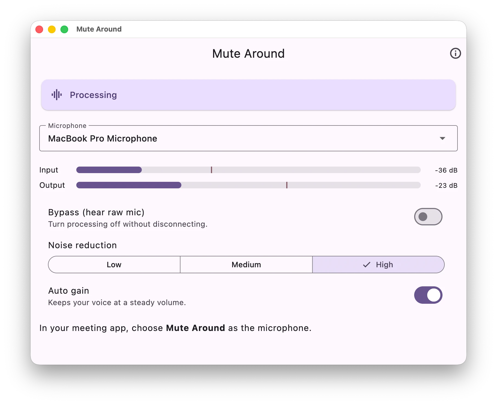

# Mute Around

Removes background noise from your microphone and keeps your voice at a
steady volume, in real time, on macOS and Windows. Zoom, Slack, Teams,
Discord, OBS and any other app hear the cleaned-up voice through a virtual
microphone.

<p align="center">
  
</p>

- **Noise suppression** with [DeepFilterNet 3](https://github.com/Rikorose/DeepFilterNet)
  (low-latency model): fans, air conditioning, hum, keyboard clicks, street
  noise. Three strengths: Low, Medium, High.
- **Auto gain**: speech-gated level control plus a limiter, so you're never
  too quiet and never clip.
- **Instant bypass** to hear your raw mic, without the meeting app losing
  its microphone. If the computer gets too busy, Mute Around switches to
  raw audio by itself instead of crackling, and resumes when it can.
- **Live meters** for the input and the cleaned output.
- **Runs in the background** from the menu bar (macOS) or the system tray
  (Windows).
- **Private**: everything runs on your computer. No network, no accounts,
  no telemetry, nothing recorded.

Adds at most ~50 ms of delay. Supported: macOS 13+ on Apple Silicon, and
Windows 10/11 on x64.

## How it works

```
microphone → noise suppression (DeepFilterNet 3) → auto gain → limiter → virtual mic → meeting app
```

- **macOS:** Mute Around installs its own virtual microphone, called
  **Mute Around** (a Core Audio plug-in). Pick it as the microphone in your
  meeting app.
- **Windows:** Mute Around plays into the free
  [VB-CABLE](https://vb-audio.com/Cable/) virtual cable. Pick
  **CABLE Output** as the microphone in your meeting app.

The app is Flutter. The real-time audio engine is a small C library
(miniaudio + DeepFilterNet's Rust core) behind one C header
(`native/engine/include/mute_engine.h`), called through `dart:ffi`.

## FFI and native interop

Dart handles UI, state and setup. Native code runs only where it has to:
the real-time audio path and the OS audio driver. The two sides meet at one
small C header.

```
 Dart (Flutter UI isolate)                 Native (libmute_engine)
 ─────────────────────────                 ───────────────────────────────────────────
 PipelineBloc                               capture callback ──► ring_in (SPSC)
   └─ use cases                                                      │
       └─ FfiEngineDataSource ──me_*()──►   processing thread (RT priority)
            (polls ≤ 30/s,                    DeepFilterNet (Rust) → AGC → limiter
             leaf calls)                                             │
                         ◄── atomics ──     levels / status    ring_out (SPSC)
                                                                     │
                                            playback callback ──► sink
                                                                     │
                              macOS: Core Audio HAL plug-in "Mute Around"
                              Windows: VB-CABLE
```

### One versioned C ABI
[`native/engine/include/mute_engine.h`](native/engine/include/mute_engine.h)
is the only boundary between Dart and native code:

- **Plain C only.** It uses opaque handles (`me_engine*`), fixed-size
  structs, and `int32_t` typedefs instead of C enums, whose size depends on
  the compiler. No C++ types or exceptions cross the boundary.
- **Errors are values.** Every fallible call returns a negative
  `me_result`, and `me_last_error` fills a caller-owned buffer with the
  details.
- **The ABI is versioned.** `me_abi_version()` returns
  `(MAJOR << 16) | MINOR`. Dart checks it before any other call and refuses
  a library with a different major version
  ([`engine_library.dart`](lib/core/native/engine_library.dart)).
- **The contract is documented.** The header spells out the call order,
  threading rules and which getters are wait-free.

### Generated bindings, bundled by build hooks
- **Bindings:** [`tool/ffigen.dart`](tool/ffigen.dart) uses ffigen's Dart
  API (not the deprecated YAML config) to generate
  [`mute_engine.ffigen.dart`](lib/core/native/mute_engine.ffigen.dart) as
  `@Native` external functions bound to the code asset
  `package:mute_around/mute_engine`. The wait-free getters
  (`me_get_status`, `me_get_levels`, `me_get_stats`) are bound as **leaf
  calls**, which skip the VM's safepoint transition. Generated bindings are
  committed, so contributors don't need LLVM.
- **Build:** [`hook/build.dart`](hook/build.dart) is a Dart build hook
  (native assets). It runs `cargo` to build the DeepFilterNet shim as a
  static library, then compiles the C engine and miniaudio with
  `native_toolchain_c` and links the two. `flutter run` builds and bundles
  everything; there are no hand-written Xcode or Visual Studio steps for the
  engine.
- **Objective-C without hand-written glue:** the macOS microphone permission
  uses ffigen's Objective-C bindings for AVFoundation
  ([`macos_permissions.dart`](lib/core/native/macos_permissions.dart)). The
  completion handler is an `ObjCBlock.listener`, which forwards a callback
  from any dispatch queue to the Dart isolate.

### Memory ownership and lifecycle
Native code owns its memory. Dart holds only an opaque pointer and releases
it explicitly:

- [`FfiEngineDataSource`](lib/features/pipeline/data/datasources/ffi_engine_data_source.dart)
  creates the engine lazily, calls `me_engine_destroy` in `dispose()`, and
  attaches a **`NativeFinalizer`** as a safety net in case the object is
  garbage-collected without being disposed. Disposing detaches the
  finalizer, so the engine is never freed twice.
- Temporary C strings and out-parameters come from an `Arena`
  (`using((arena) { ... })`), so they're freed when the call returns.
- Everything native is caught at the `data/` boundary and mapped to a typed
  `Failure` in a `Result`
  ([`engine_errors.dart`](lib/core/native/engine_errors.dart)). Nothing
  throws into the domain or UI layers.

### Real-time audio thread rules
The audio callbacks and the processing thread **never allocate, lock, do
I/O, log or call into Dart**:

- **Lock-free SPSC ring buffers**
  ([`ring_buffer.h`](native/engine/src/ring_buffer.h)) connect the capture
  callback, the processing thread and the playback callback. Settings
  (bypass, AGC, strength) are atomic stores that are read once per 10 ms hop.
- **Dart polls; native never calls back.** Meters are read with wait-free
  getters at most ~30 times a second, and only while the window is visible.
  Status is polled the same way. Nothing on the audio path waits on the Dart
  VM.
- **Real-time priority:** the processing thread runs with macOS QoS
  `USER_INTERACTIVE` or Windows MMCSS "Pro Audio"
  ([`rt_thread.c`](native/engine/src/rt_thread.c)).
- **A real-time allocator for Rust.** DeepFilterNet (libDF + tract)
  allocates around 800 small tensors per 10 ms frame.
  [`rt_alloc.rs`](native/engine/dfshim/src/rt_alloc.rs) is a global
  allocator that serves the processing thread from a preallocated pool:
  power-of-two size classes with O(1) free lists and a lock-free stack for
  blocks freed from other threads. Other threads use the system allocator
  unchanged.
- **Tested:** [`test_no_alloc`](native/engine/tests/test_no_alloc.c)
  intercepts `malloc` and its relatives (dyld interposing on macOS) and
  asserts **zero system-heap allocations per hop** across 1,000 processed
  hops, plus zero pool fallbacks.
- **Graceful overload.** If processing falls behind, the engine crossfades
  to raw audio instead of crackling and returns when the CPU recovers.

### The macOS virtual microphone
[`native/macos_hal/src/plugin.cpp`](native/macos_hal/src/plugin.cpp) is a
Core Audio **Audio Server plug-in** (built on libASPL) that runs inside
`coreaudiod`. It publishes a "Mute Around" device: the app plays into its
output, and meeting apps record from its input. The loopback is a ring
indexed by device sample time, so any number of apps can read at once,
readers get silence when the app isn't running, and it adds about one IO
cycle of latency. Its IO callbacks follow the same real-time rules.

### Testing across the boundary
- **Native:** C unit tests and WAV-fixture tests (noisy input → measured
  output), plus the zero-allocation test, run with CTest
  ([`native/engine/tests/`](native/engine/tests)).
- **Dart against the real library:**
  [`engine_lifecycle_test.dart`](test/core/native/engine_lifecycle_test.dart)
  drives create/start/stop/destroy and the error paths through FFI. Setting
  `MUTE_ENGINE_BACKEND=null` switches to miniaudio's null backend, so these
  tests run in CI without audio hardware.
- **Dart, mocked:** repositories, use cases and blocs are tested with fakes
  of the layer below.

## Build from source

Signed installers aren't available yet; build it yourself.

### Prerequisites

| Tool | macOS (Apple Silicon) | Windows 10/11 x64 |
|---|---|---|
| Flutter | 3.50+ stable | 3.50+ stable |
| Rust | stable ≥ 1.70 via [rustup](https://rustup.rs) | stable ≥ 1.70, MSVC toolchain |
| C/C++ toolchain | Xcode + Command Line Tools | Visual Studio 2022 Build Tools (C++) |
| CMake | ≥ 3.24 (`brew install cmake`) | ≥ 3.24 |
| Virtual mic | built by this repo | [VB-CABLE](https://vb-audio.com/Cable/) |

### Steps

```bash
git clone --recurse-submodules https://github.com/ahmeddhus/mute_around.git
cd mute_around
flutter pub get
dart run build_runner build -d
flutter run -d macos        # or: flutter run -d windows
```

Already cloned without submodules? Run
`git submodule update --init --recursive`.

Using [Claude Code](https://claude.com/claude-code)? Run `/setup-macos` or
`/setup-windows`. Each one checks the prerequisites, suggests what to install
and then builds and runs the app. The skills are in `.claude/skills/`.

The first build takes a few minutes: the Dart build hook (`hook/build.dart`)
compiles the engine and DeepFilterNet with cargo. On macOS an Xcode build
phase also builds the `MuteAround.driver` plug-in into the app bundle.

### First run

- **macOS:** the setup screen asks for microphone access, then offers
  **Install Mute Around microphone**. This asks for your administrator
  password once: it copies the plug-in to `/Library/Audio/Plug-Ins/HAL` and
  restarts Core Audio.
- **Windows:** install [VB-CABLE](https://vb-audio.com/Cable/) (run its
  installer as administrator and restart if asked). Mute Around detects it
  by itself; you can also press **Check again**. If Windows blocks the
  microphone, allow desktop apps under Settings → Privacy → Microphone.

Processing starts automatically. Then pick **Mute Around** (macOS) or
**CABLE Output** (Windows) as the microphone in your meeting app.

## Uninstall the macOS virtual microphone

```bash
sudo rm -rf /Library/Audio/Plug-Ins/HAL/MuteAround.driver
sudo killall -9 coreaudiod
```

Or run `native/macos_hal/scripts/dev_uninstall.sh`. Core Audio restarts and
the "Mute Around" device disappears.

## Development

```bash
dart run build_runner build -d      # generated code (not committed)
flutter analyze --fatal-infos
dart format .
flutter test

# Native engine tests (unit + WAV fixtures + zero-allocation check)
cmake -S native/engine -B build/native-tests -DCMAKE_BUILD_TYPE=Release
cmake --build build/native-tests
ctest --test-dir build/native-tests --output-on-failure
```

- Regenerate the FFI bindings after changing `mute_engine.h` (needs LLVM;
  Xcode's on macOS): `dart run tool/ffigen.dart`. The macOS permission
  bindings come from `dart run tool/ffigen_avfoundation.dart`. Both outputs
  are committed.
- Install the macOS plug-in by hand while developing:
  `native/macos_hal/scripts/dev_install.sh`.
- The project's rules are in [`CLAUDE.md`](CLAUDE.md).

## License

Mute Around is released under the [MIT License](LICENSE).

## Third-party licenses

Third-party components and their licenses are listed in
[THIRD_PARTY_NOTICES.md](THIRD_PARTY_NOTICES.md); only permissive licenses
are used. The app also shows them under About → Open-source licenses.
